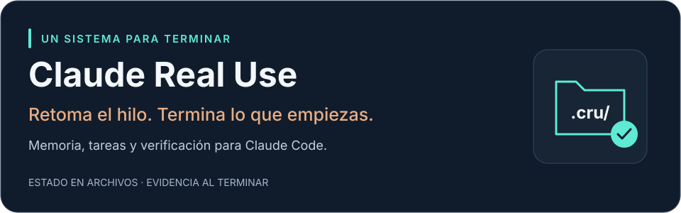
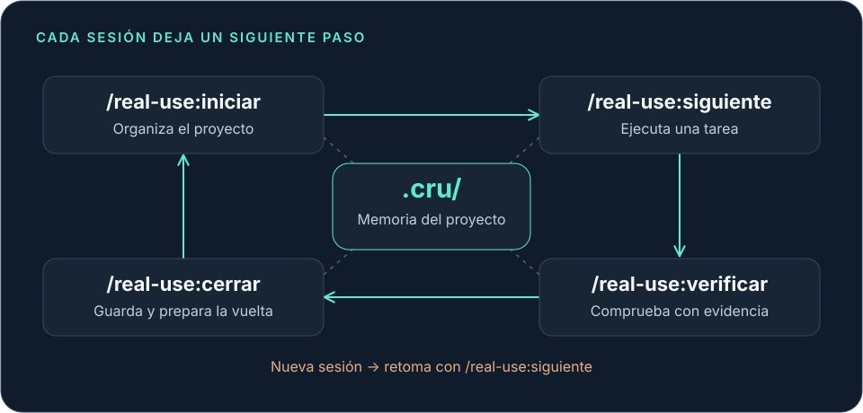

<p align="center">
  
</p>

<p align="center">
  
  <a href="LICENSE"></a>
  
  
</p>

<p align="center">
  <strong>El plugin de Claude Code que guarda el estado de tu proyecto y convierte peticiones en tareas verificables.</strong><br>
  Para terminal y app de escritorio. Memoria en <code>.cru/</code>, una tarea por sesión y un cierre listo para retomar.
</p>

<p align="center">
  <a href="GUIA.md">Guía y fuentes oficiales</a> · <a href="PROMPTS.md">Prompts para copiar</a> · <a href="plugins/real-use/skills/">Explorar las skills</a>
</p>

## ⚡ Instalación rápida

Requisitos: **Claude Code reciente y Node.js en el PATH** (lo usa el hook de inicio de sesión).

En Claude Code, añade el repositorio de GitHub e instala el plugin:

```text
/plugin marketplace add Cukiti/claude-real-use
/plugin install real-use@real-use
/reload-plugins
```

Si el repositorio es privado para tu cuenta, necesitas acceso y git autenticado, por ejemplo con `gh auth login`.

## 🚀 Empieza en 1 minuto

Ejecuta estos comandos uno a uno en tu proyecto y responde a las opciones que aparezcan:

```text
/real-use:iniciar un roguelike de cartas para móvil en Godot
/real-use:siguiente
/real-use:cerrar
```

El primero organiza el proyecto; el segundo toma una tarea y la verifica; el tercero escribe el estado y deja una frase para retomar. El minuto es para arrancar: la duración de la tarea depende del proyecto.

## 💡 ¿Por qué?

Se cierra una sesión y se pierde el hilo. Vuelves a explicar el proyecto, quemas tokens reconstruyendo contexto y acumulas tareas a medias. **Real Use propone guardar el trabajo en archivos y comprobar cada avance.**

- 🧠 **Retoma con memoria:** `.cru/` conserva objetivo, tareas, bitácora y decisiones; el hook carga un resumen al abrir sesión.
- 🎯 **Termina una tarea cada vez:** criterio de terminado, verificación ejecutable y evidencia antes de marcarla como hecha.
- 🪙 **Cuida el contexto:** modelo y esfuerzo según la tarea, auditoría de tokens y avisos del copiloto sobre contexto, caché y correcciones.
- 🧭 **Deja preparado el siguiente paso:** cierre con estado escrito, cabos sueltos registrados y un prompt para continuar.

El método es explorar → planificar → implementar → verificar. Para cambios grandes, primero entrevista y especificación; esfuerzo medio por defecto. Delega lo que lee mucho y devuelve poco, y reserva las sesiones paralelas para tareas independientes. La explicación y las fuentes de Anthropic están en [GUIA.md](GUIA.md).

## 🔄 Un ciclo para avanzar

<p align="center">
  
</p>

Al abrir una sesión nueva, Claude recibe la fase, la tarea en curso, las siguientes y la última entrada de la bitácora. Las opciones se presentan como preguntas para elegir, con la recomendación primero: tú eliges y Claude ejecuta.

<!-- demo.gif -->
**La demo está por llegar.** Aquí verás el ciclo completo en acción.

## 🧰 Las 18 skills

| | Comando | Para qué sirve |
|---|---|---|
| 🧭 | `/real-use:menu` | Tablero de «¿qué hago ahora?» con botones u opciones y chuleta de comandos. |
| 🗺️ | `/real-use:mapa` | Mapa visual del proyecto generado por script, sin coste de modelo. |
| ⚙️ | `/real-use:automatizar` | Propone hooks, tareas programadas, routines y Actions; tú apruebas los cambios. |
| 🤖 | `/real-use:bot` | Configura un bot de revisión con criterios en `REVIEW.md` que aprende de cada sesión. |
| ✍️ | `/real-use:hacer` | Convierte una petición vaga en una tarea completa y la ejecuta. |
| 👥 | `/real-use:equipo` | Coordina agentes con roles y lentes, modelo y esfuerzo propios. |
| 🔌 | `/real-use:conectar` | Elige qué MCPs, conectores, plugins y CLIs añadir y cuáles quitar. |
| 🔎 | `/real-use:experto` | Aplica lentes expertas con criterios, antipatrones y verificación. |
| 🌱 | `/real-use:iniciar` | Detecta el proyecto, entrevista, elige metodología y crea `.cru/`. |
| 📐 | `/real-use:spec` | Transforma una idea grande o ambigua en especificación y tareas verificables. |
| ▶️ | `/real-use:siguiente` | Toma la siguiente tarea, decide cómo ejecutarla, la hace y la verifica. |
| 🛤️ | `/real-use:enrutar` | Decide modelo, esfuerzo, agente y tipo de sesión para una tarea. |
| ✅ | `/real-use:verificar` | Ejecuta la verificación y, en cambios no triviales, una revisión adversarial en contexto fresco. |
| 📋 | `/real-use:pendientes` | Audita cabos sueltos y propone convertirlos en tareas. |
| 🌙 | `/real-use:cerrar` | Actualiza tareas, bitácora y decisiones; deja un prompt para retomar. |
| 🌿 | `/real-use:paralelo` | Reparte tareas independientes en sesiones, cada una con su worktree. |
| 🪙 | `/real-use:ahorro` | Audita el consumo de tokens de tu configuración y propone recortes. |
| 📊 | `/real-use:panel` | Instala una línea de estado en terminal con modelo, tarea y porcentaje de contexto. |

### Uso diario

```text
/real-use:hacer quiero que el menú se vea más profesional            ← cualquier petición, en tus palabras
/real-use:iniciar un roguelike de cartas para móvil en Godot      ← una vez por proyecto
/real-use:siguiente                                              ← cada sesión
/real-use:spec sistema de guardado en la nube                    ← antes de una funcionalidad grande
/real-use:verificar                                              ← antes de dar algo por terminado
/real-use:cerrar                                                 ← al terminar la sesión
/clear                                                           ← entre tareas no relacionadas
```

## 📦 Otras formas de instalación

**Desde una carpeta local**, ejecuta en la terminal (con `claude-real-use` en el directorio actual):

```bash
claude plugin marketplace add ./claude-real-use
claude plugin install real-use@real-use --scope user
```

**Para probarlo sin instalarlo**, desde esa misma ubicación:

```bash
claude --plugin-dir ./claude-real-use/plugins/real-use
```

Si ya estás dentro del repositorio clonado, usa `claude --plugin-dir ./plugins/real-use`.

## 🧠 La memoria del proyecto

`PROJECT.md` guarda el objetivo y qué significa terminado; `TASKS.md`, el trabajo; `LOG.md`, la bitácora; y `DECISIONS.md`, el porqué de las decisiones.

### Formato de `.cru/TASKS.md`

```markdown
## En curso
- [~] T-003 Guardado local · hecho: partida se restaura tras cerrar · verif: `godot --headless -s addons/gut/gut_cmdln.gd` · queda: serializar inventario
## Pendiente
- [ ] T-004 Menú de pausa · hecho: pausa/continúa/sale · verif: test de escena
## Bloqueado
- [!] T-007 Logros de Play Games · bloqueado por: cuenta de desarrollador
## Hecho
- [x] T-001 Bucle de combate · ✔ 2026-10-15
```

Los archivos `.cru/` van en git: son la memoria del proyecto, y así el equipo y las sesiones en la nube la comparten. La carpeta [.cru/](.cru/) de este repositorio es un ejemplo real.

## 📊 Qué aporta, medido

Evaluaciones de resultado (`npm run evals:resultado`): la misma tarea, con el plugin y sin él, puntuada por lo que queda escrito en disco o en la respuesta.

| Caso | Con plugin | Sin plugin | Δ |
|---|---|---|---|
| Cerrar la sesión: tarea marcada y prompt para retomar en la bitácora | 1,00 | 0,50 | **+0,50** |
| `/real-use:hacer` con una petición vaga: ficha con terminado y verificación | 1,00 | 0,00 | **+1,00** |
| Hacer la siguiente tarea simple y actualizar `TASKS.md` | 1,00 | 1,00 | 0 |
| Revisar un CSS con criterio de diseño | 0,88 | 0,88 | 0 |
| Cerrar en un proyecto con seguimiento propio (bitácora con la entrada arriba) | 1,00 | 1,00 | 0, pero antes del arreglo era 0,67: la evaluación detectó una contradicción interna |

Lectura honesta: en tareas simples Claude ya lo hace bien sin ayuda. El plugin aporta en la **continuidad entre sesiones** y en convertir peticiones vagas en trabajo verificable. Esos dos puntos son justo los que hacen que los proyectos se queden a medias.

## 🗂️ Qué incluye el repositorio

Además del plugin: [guía con fuentes](GUIA.md), [prompts para copiar](PROMPTS.md) y [plantillas de usuario](plantillas-usuario/) para tu `~/.claude/CLAUDE.md`.

<details>
<summary>Ver la estructura completa</summary>

```
claude-real-use/
├── GUIA.md                      ← cómo usar Claude de verdad (con fuentes)
├── PROMPTS.md                   ← prompts listos para copiar y pegar
├── assets/                      ← banner, diagrama y futura demo
├── plantillas-usuario/          ← bloque recomendado para tu ~/.claude/CLAUDE.md
├── .cru/                        ← este repo usa su propio sistema (ejemplo real)
├── tests/                       ← tests de los scripts (npm test)
└── plugins/real-use/            ← el plugin
    ├── skills/
    │   ├── menu/                /real-use:menu       ¿qué hago ahora? tablero con botones + chuleta
    │   ├── mapa/                /real-use:mapa       mapa visual del proyecto (script, sin coste de modelo)
    │   ├── automatizar/         /real-use:automatizar hooks, tareas programadas, routines, Actions (apruebas tú)
    │   ├── bot/                 /real-use:bot        bot de revisión con REVIEW.md que aprende
    │   ├── hacer/               /real-use:hacer      cualquier petición vaga → tarea completa → hecha
    │   ├── equipo/              /real-use:equipo     agentes con roles (lentes), modelo y esfuerzo propios
    │   ├── conectar/            /real-use:conectar   MCPs, conectores, plugins y CLIs: qué añadir y qué quitar
    │   ├── experto/             /real-use:experto    lentes expertas: criterios, antipatrones, verificación
    │   ├── iniciar/             /real-use:iniciar    detecta, entrevista, elige metodología, crea .cru/
    │   ├── spec/                /real-use:spec       idea vaga → spec → tareas verificables
    │   ├── siguiente/           /real-use:siguiente  toma la siguiente tarea, la enruta, la verifica
    │   ├── enrutar/             /real-use:enrutar    modelo / esfuerzo / agente / sesión para cada tarea
    │   ├── verificar/           /real-use:verificar  verificación + revisor adversarial
    │   ├── pendientes/          /real-use:pendientes cabos sueltos → tareas
    │   ├── cerrar/              /real-use:cerrar     cierre de sesión sin pendientes
    │   ├── paralelo/            /real-use:paralelo   tareas independientes → sesiones en worktrees
    │   ├── ahorro/              /real-use:ahorro     auditoría de tokens de tu configuración
    │   └── panel/               /real-use:panel      línea de estado: tarea en curso + % de contexto
    ├── agents/                  explorador (Haiku) · verificador (Sonnet) · revisor · especialista (con lente)
    ├── hooks/                   inicio: estado de .cru/ · copiloto: avisos de contexto, caché, esfuerzo y correcciones
    ├── scripts/                 session-start.js · copiloto.js · statusline.js · mapa.js
    ├── referencias/             metodologías · verificación · catálogo gratis/pago · entrega · cuestionarios · lentes/
    └── plantillas/              PROJECT · TASKS · LOG · DECISIONS
```

</details>

## 🛠️ Desarrollo

La validación de manifiestos (`npm run validate`) requiere la CLI `claude`.

```bash
npm test
```

```bash
npm run validate
```

Evaluaciones de activación: 16 casos que comprueban que cada frase activa la skill correcta y no la competidora (`hacer` frente a `experto` o `spec`), y que las preguntas normales no activan ninguna. Los casos se definen en [scripts/generar-evals.js](scripts/generar-evals.js). Cuestan unos $3,50 con 3 ejecuciones por caso, así que no corren en CI: lánzalas cuando cambies la descripción de una skill.

```bash
npm run evals:generar
```

```bash
npm run evals
```

## 📜 Licencia

[MIT](LICENSE) · Copyright (c) 2026 Anderson Carrasco.

## 🎬 Cómo grabar la demo

1. Instala [VHS, herramienta gratuita para grabar GIFs de terminal](https://github.com/charmbracelet/vhs#installation), con `ttyd` y `ffmpeg` disponibles en el PATH.
2. Desde la raíz del repositorio, ejecuta `vhs record > assets/demo.tape`. Entra en Claude Code con el plugin y muestra el ciclo iniciar → siguiente → verificar → cerrar en un proyecto de ejemplo. Sal de Claude Code y después del shell de grabación con `exit`.
3. Revisa `assets/demo.tape`: establece `Output assets/demo.gif`, ajusta las pausas y elimina datos privados. Genera el GIF con `vhs assets/demo.tape` y comprueba que los comandos y sus resultados se lean bien.
4. Sustituye el comentario `<!-- demo.gif -->` y el aviso de demo pendiente por una imagen Markdown con texto alternativo y ruta `assets/demo.gif`.
